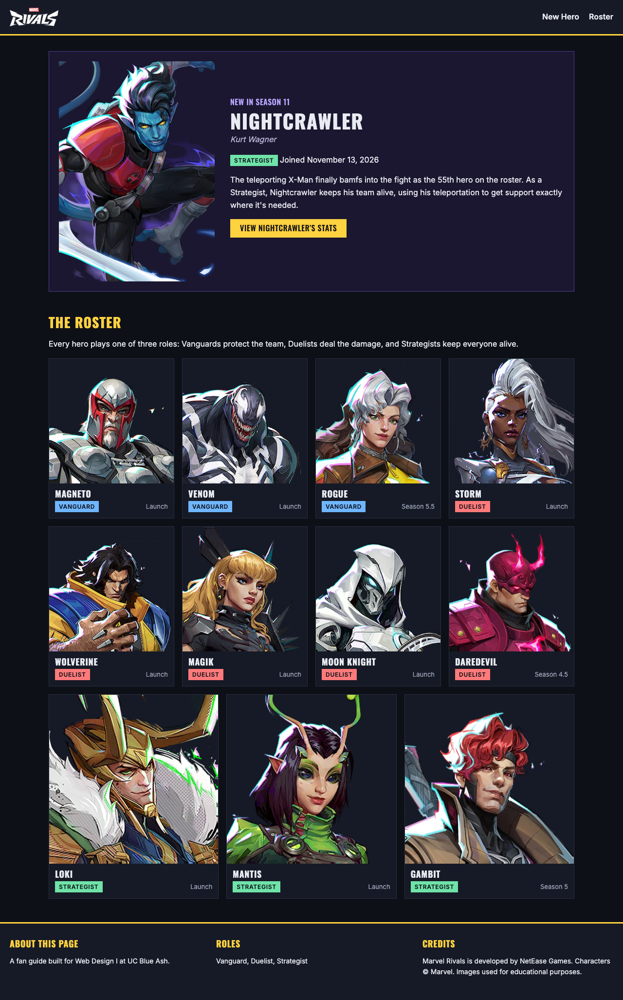
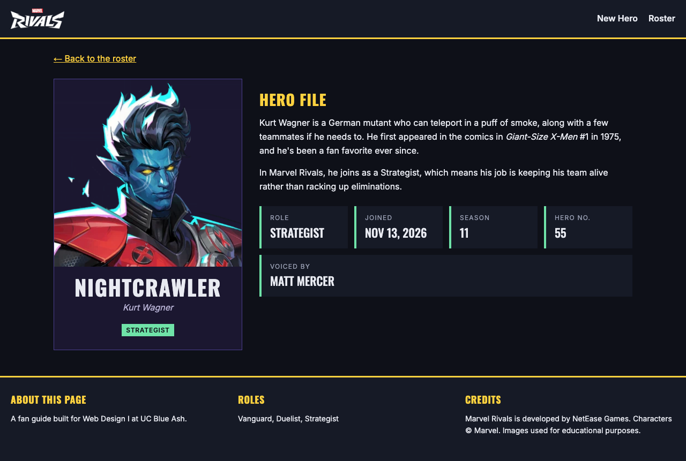

# 🦸 Rivals Roster: Flexbox Layout

## 🎯 Overview

Rivals Roster is a fan guide to the Marvel Rivals roster, built around Nightcrawler, the newest Strategist in
Season 11. The HTML and `css/base.css` are finished. `base.css` sets the colors, fonts, and spacing, but it has no
layout rules on purpose, so every section is stacked in normal flow. You'll write the layout with Flexbox in a new
stylesheet, `css/layout.css`, until both pages match the screenshots below.

## 📋 Requirements

### Setup

- [ ] Create `css/layout.css`
- [ ] Link `css/layout.css` in **both** `index.html` and `nightcrawler.html`, **after** `css/base.css`
- [ ] Don't edit `css/base.css` or the HTML. All of your CSS goes in `css/layout.css`

### Both pages

- [ ] **Header:** the logo sits on the left and the nav on the right, vertically centered
- [ ] **Nav:** the two links sit in a row with space between them
- [ ] **Footer:** the three columns sit side by side and share the width equally

### Home page (`index.html`)

- [ ] **Featured hero:** the Nightcrawler portrait sits to the left of the text, and the text is vertically centered
  next to it
- [ ] **Roster:** the hero cards wrap into rows of four, with a gap between cards
- [ ] **Roster:** cards in the last row grow to fill the leftover space
- [ ] **Hero cards:** the role badge sits on the left and the "joined" text on the right, on the same line

### Nightcrawler page (`nightcrawler.html`)

- [ ] **Profile:** the profile card sits to the left of the Hero File text
- [ ] **Stats:** the stat boxes wrap into rows, with a gap between them, and "Voiced by" grows to fill its row

### Code quality

- [ ] Use Flexbox for every layout above. No `float`, `position`, or `grid`
- [ ] Use the existing elements, IDs, and classes as selectors. Don't add classes or IDs to the HTML
- [ ] Comment each section of `layout.css` so it's clear which part of the page it lays out

## 🖼️ Example Output

This is what both pages should look like when you're done.

### Home page

### Nightcrawler page

## 📂 Starter Files

| File / Folder       | Purpose                                                                   |
|---------------------|---------------------------------------------------------------------------|
| `index.html`        | Home page: header, featured hero, roster, footer. **Don't edit.**         |
| `nightcrawler.html` | Nightcrawler's stats page. **Don't edit.**                                |
| `css/base.css`      | Colors, fonts, and spacing. No layout. **Don't edit.**                    |
| `css/layout.css`    | **You create this.** All of your Flexbox layout goes here.                |
| `images/`           | Hero portraits (`.webp`) and the two finished screenshots (`final*.png`). |

## 🧮 Grading

| Criteria                                                  | Points  |
|-----------------------------------------------------------|---------|
| `layout.css` created and linked on both pages             | 1       |
| Header, nav, and footer layout on both pages              | 3       |
| Featured hero layout                                      | 2       |
| Roster cards: wrapping, gaps, last row, badge row         | 4       |
| Nightcrawler profile and stats layout                     | 3       |
| Code quality: Flexbox only, no HTML edits, comments       | 2       |
| **Total**                                                 | **15**  |

## 📚 Resources

- [MDN: Basic concepts of Flexbox](https://developer.mozilla.org/en-US/docs/Web/CSS/CSS_flexible_box_layout/Basic_concepts_of_flexbox)
- [CSS-Tricks: A Complete Guide to Flexbox](https://css-tricks.com/snippets/css/a-guide-to-flexbox/)
- [Flexbox Froggy](https://flexboxfroggy.com/)

## 🆘 Getting Help

Ask during class or office hours, or post on the Canvas discussion board.

---

The AI policy and submission instructions are in the [README](../README.md).
